<!-- ============================================================
  Profile README for github.com/aiimallkhann/aiimallkhann
  Everything below is generated live: each image is fetched fresh
  from a service (or from your own GitHub Action) when the page loads.
  Find/replace "aiimallkhann" if your GitHub handle is spelled differently.
============================================================= -->

<!-- Animated waving header -->

<!-- Typing animation -->

 

<!-- Live badges -->

  

> *“I believe in building technology with one focus: making powerful tools accessible to people. Not necessarily free, but fundamentally accessible.”*

---

## 👋 About me

- 🎓 Computer Science student on a self-directed path to **ML engineering**
- 🔭 Currently building **[Atlas](https://github.com/aiimallkhann/atlas)**, a local-first document search and question-answering pipeline
- 🌱 Working through ML fundamentals one project at a time
- 🎯 Goal: build AI tools that real people can actually use

---

## ⚙️ Tech stack

  &nbsp;&nbsp;&nbsp;
  &nbsp;&nbsp;&nbsp;
  &nbsp;&nbsp;&nbsp;
  &nbsp;&nbsp;&nbsp;
  &nbsp;&nbsp;&nbsp;
  &nbsp;&nbsp;&nbsp;
  
    
  &nbsp;&nbsp;&nbsp;
  &nbsp;&nbsp;&nbsp;
  &nbsp;&nbsp;&nbsp;
  &nbsp;&nbsp;&nbsp;
  &nbsp;&nbsp;&nbsp;
  

---

## 📊 Live GitHub analytics

<!-- These cards are generated by .github/workflows/profile-cards.yml and committed
     to this repo every day, so they don't depend on any third-party server. -->

 

 

---

## 🐍 Contribution snake

  <picture>
    <source media="(prefers-color-scheme: dark)" srcset="https://raw.githubusercontent.com/aiimallkhann/aiimallkhann/output/github-snake-dark.svg" />
    <source media="(prefers-color-scheme: light)" srcset="https://raw.githubusercontent.com/aiimallkhann/aiimallkhann/output/github-snake.svg" />
    
  </picture>

---

## 📫 Let's connect

I'm happy to talk about ML, open projects, and ways to make AI more accessible.

<a href="https://www.linkedin.com/in/aimal-khan-96a4b1375/">LinkedIn</a> &nbsp;•&nbsp; <a href="mailto:aiimallkhann@gmail.com">Email</a>

